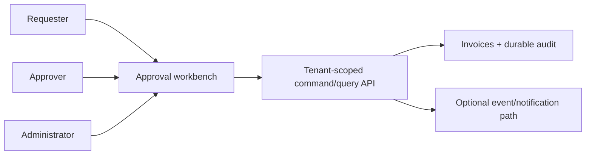

# H1 — Approval Workbench

## Product brief

Build a small approval workbench for accounts-payable users. A requester submits invoices, approvers review them, and an administrator can inspect the audit history. The application should make state and authority clear even when two people act at nearly the same time.

Use any appropriate stack. The result should be deployed or reproducibly deployable using synthetic data.

## Core user outcome

An authenticated demo user can:

1. view only invoices available to their company and role;
2. inspect invoice amount, currency, vendor, due date, status, and approval history;
3. approve or reject an eligible invoice;
4. receive an honest result if the invoice changed after they opened it.

## Suggested domain

```text
Company: id, name
User: id, company_id, role
Invoice: id, company_id, vendor_name, total_minor_units, currency,
         due_date, status, version, submitted_by
ApprovalEvent: id, company_id, invoice_id, actor_id, action,
               from_status, to_status, created_at
```

Suggested states are `DRAFT → PENDING → APPROVED` or `REJECTED`. You may define a different state model if you document it. Approval is not payment.

Seed at least two companies and three roles/actors so tenant and authorization behavior can be demonstrated.

## Conceptual boundary



The diagram describes product responsibilities, not a required architecture. A monolith, serverless app, local-first prototype, or other coherent design is acceptable.

## Non-negotiable behaviors

- A user cannot read or mutate another company’s invoice by changing a URL, request body, or client state.
- The server or authoritative backend validates the actor and current transition. Hiding a button is not sufficient.
- Financial values use exact minor units/decimal rules and include currency.
- The audit trail identifies who did what and when.
- A stale or duplicate approval never silently performs the action twice.
- Demo and test data contains no real customer information.

You may simplify login with seeded session controls or demo credentials, but explain what is trusted and how production authentication would connect.

## Scope options

Any time box is valid. If you have two hours, choose the smallest meaningful path, state what you omitted, and explain what you would do next. You do not need to implement every core outcome; any behavior you do implement should preserve the non-negotiable invariants.

### Compact: five hours or less

Possible shape—choose a coherent subset rather than treating this as a checklist:

- Invoice list and detail for one seeded role at a time.
- Approve/reject command with tenant scope and current-state validation.
- Persistent or deterministic local data.
- Audit history.
- A few automated tests for another-tenant access, disallowed state, and a successful transition.
- Deployable build and clear setup instructions.

### Extension menu: optional, more than five hours up to a week

- Requester, approver, and admin experiences.
- Filtering/pagination and accessible loading, empty, conflict, and failure states.
- Expected-version or equivalent stale-update behavior.
- Idempotency for client retries.
- Better test coverage and CI.
- Deployed preview with health/logging basics.
- Multi-step policies, delegation, or approval limits.
- Realtime updates that reconcile with authoritative state.
- Transactional audit/outbox and duplicate-tolerant notifications.
- Feature-flagged rollout, metrics, tracing, and operational repair tools.
- Backward-compatible API/schema evolution plan.

Choose only extensions that strengthen a coherent product. More extensions do not produce a higher score by themselves, and a broad workflow engine is not required.

## Useful edge cases

- Two approvers open version 7; one approves before the other rejects.
- The browser times out after the server commits an approval.
- A user loses approver permission while the page remains open.
- An invoice belongs to company B but its numeric ID is guessed by company A.
- A realtime event arrives before the original command response.

## Expected discussion

Be prepared to explain:

- where tenant identity and authorization become authoritative;
- the approval invariants and concurrency mechanism;
- idempotency versus optimistic concurrency;
- why your audit record is—or is not—atomic with the transition;
- user experience during an ambiguous network failure;
- which tests give the most confidence;
- how your deployment would roll forward and back;
- assumptions or defects introduced by AI/tools and how you found them.

## Optional creative directions

You may add a mobile client, accessible enterprise grid, rule visualizer, notification simulator, policy explanation, or AI-generated approval summary. If AI summarizes an invoice, keep source data visible and never let generated text authorize or execute the action.
